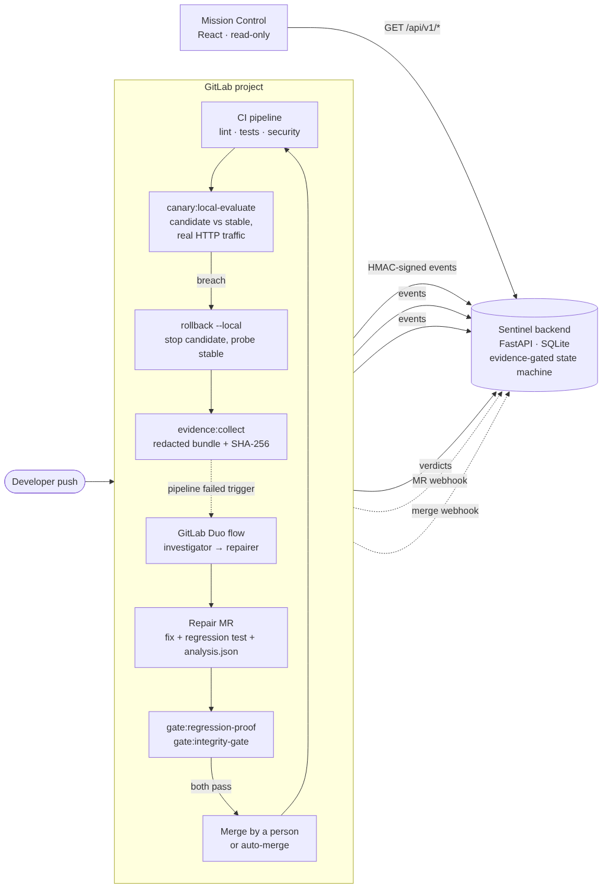
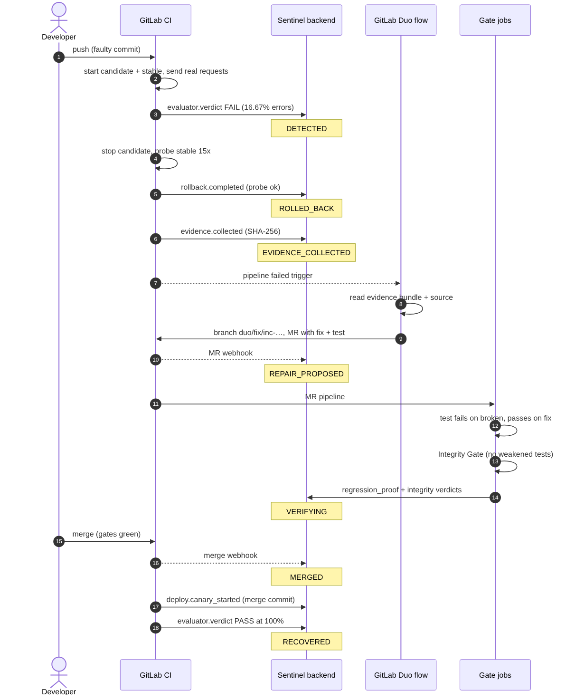
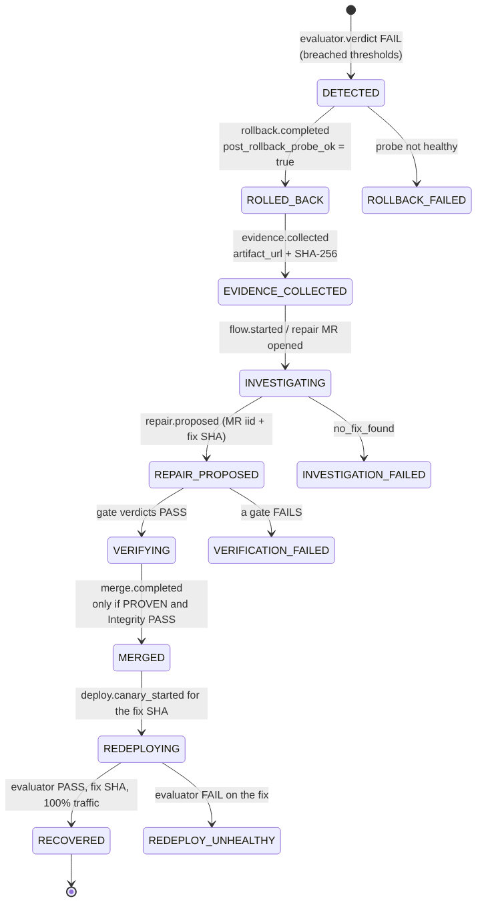
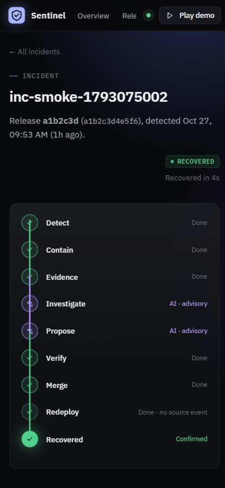
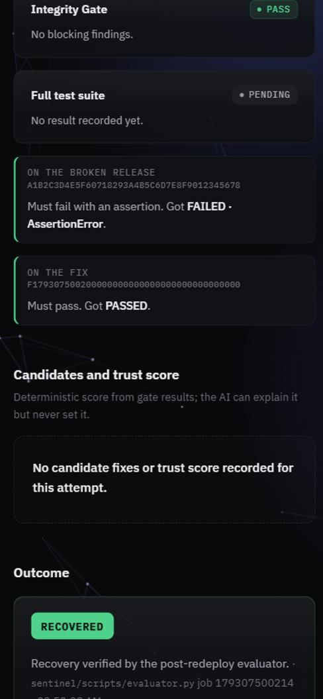
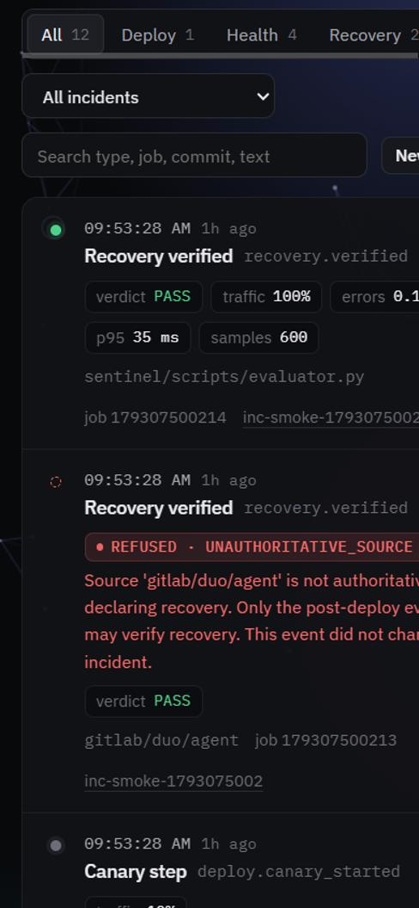
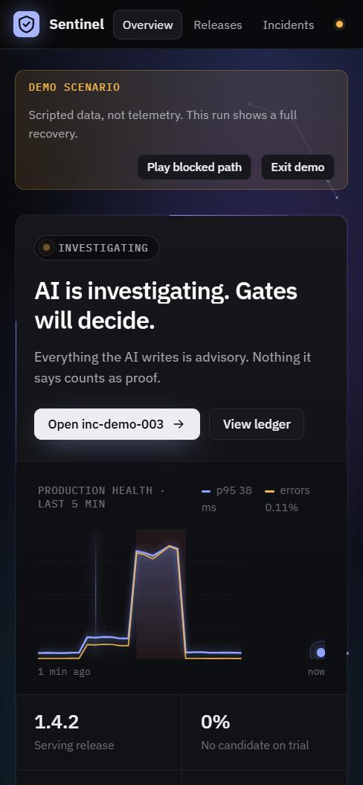

# Project Sentinel — Technical Documentation

**AI proposes. Deterministic gates decide. Production evidence proves the outcome.**

Sentinel is a deployment-safety and recovery loop built on GitLab. When a release makes the service unhealthy, Sentinel detects it with measured traffic, contains it, seals the evidence, asks a GitLab Duo flow for a fix, proves that fix with deterministic CI gates, and marks the incident recovered only when the merged code passes the same health check.

Live project: <https://gitlab.com/gitlab-ai-hackathon/transcend-october-2026/43057900/showcase> · Dashboard: <https://showcase-46f803.gitlab.io/>

---

## 1. Architecture



| Component | Path | Technology | Responsibility |
|---|---|---|---|
| Demo service | `app/` | FastAPI | Orders API that Sentinel releases, breaks and repairs |
| CI pipeline | `.gitlab-ci.yml` | GitLab CI | Lint, tests, security, canary, rollback, evidence, gates, merge, Pages |
| Pipeline scripts | `sentinel/scripts/` | Python | Evaluator, rollback, evidence collector, regression proof, Integrity Gate, verdict reporter, auto-merge, event emitter |
| AI flow | `.gitlab/duo/flows/sentinel-investigate-repair.yml` | GitLab Duo Agent Platform | Investigator and repairer agents; read evidence, open the repair MR |
| Backend | `backend/` | FastAPI + SQLite | Signed event intake, GitLab webhooks, evidence-gated state machine, audit ledger, read API |
| Mission Control | `frontend/` | React + Vite | Read-only console over the backend; labelled demo mode |
| Contracts | `docs/contracts/` | JSON Schema | Event, evidence bundle and analysis formats |
| Infrastructure | `infra/` | Terraform | Cloud Run, Artifact Registry, WIF, Secret Manager (cloudrun mode) |

**Trust boundary.** Only CI jobs (with the HMAC secret) and GitLab (with the webhook token) can write. The AI flow can only create branches, commits and merge requests. The browser can only read.

## 2. The recovery loop



1. **Detect.** `canary:local-evaluate` starts the pushed commit as the candidate and the previous commit as stable, sends the same synthetic requests to both, and compares error rate and p95 latency against `sentinel/policy.yaml`.
2. **Contain.** On a breach the job stops the candidate and runs `rollback.py --local`, which probes the stable app 15 times. A rollback is reported only if every probe succeeds. In `cloudrun` mode the same script shifts 100% of traffic back to the stable revision first.
3. **Evidence.** `evidence:collect` builds a redacted bundle (evaluator report, diff, commit metadata, logs) and seals it with SHA-256.
4. **Investigate and propose.** The failed pipeline triggers the Duo flow. The investigator separates *facts* (each with an evidence reference) from *hypotheses* (each with a confidence). The repairer opens `duo/fix/<incident>` with the smallest fix, one new regression test and `analysis.json`.
5. **Verify.** The MR pipeline runs both gates (section 5). Their verdicts are reported to the backend.
6. **Merge.** Only after both gates pass, a person merges (or `merge:auto-merge` with a project token).
7. **Redeploy and recover.** The merge commit goes through the canary. A PASS at 100% for the fix SHA is the only signal that marks the incident `RECOVERED`.

## 3. Incident state machine



Implemented in `backend/app/state_engine.py`. Every transition needs specific evidence; anything else is **refused** and recorded in the ledger with a reason.

| Rule | Example of a refused event |
|---|---|
| Recovery can only come from the evaluator, for the fix SHA, at 100% traffic | AI agent sends `recovery.verified` → `UNAUTHORITATIVE_SOURCE` |
| No skipping stages | `recovery.verified` while `DETECTED` → refused with 409 |
| A rollback needs a healthy post-rollback probe | `post_rollback_probe_ok: false` → `ROLLBACK_FAILED` |
| A merge needs both gate verdicts | merge without PROVEN + PASS → `ESCALATED` |
| A deploy of another commit does not count as the redeploy | re-run of the faulty release moves nothing |

One incident follows a release across pipelines: the evaluator FAIL opens `inc-<pipeline id>`, the evidence collector's id becomes an alias, and the fix and merge SHAs are linked to it.

## 4. Health evaluation

Thresholds from `sentinel/policy.yaml`:

| Check | Limit |
|---|---|
| Candidate error rate | ≤ 2% |
| Error rate delta vs stable | ≤ +1 percentage point |
| Candidate p95 latency | ≤ 300 ms |
| p95 ratio vs stable | ≤ 1.30×, and only when the slowdown is also > 50 ms |
| Error-budget burn rate | ≤ 14.4× |

The seeded fault (`docs/demo/fault-discount-lookup.patch`) removes case normalisation from the discount lookup. Requests with tiers like `"Premium"` fail, so the candidate shows **16.67%** errors while stable shows 0%.

## 5. Deterministic gates

**Regression proof** (`sentinel/scripts/regression_proof.py`). The AI's new test runs twice: on the broken commit it must fail with an `AssertionError` (a crash or import error is not proof); on the fix it must pass. Otherwise the verdict is `REJECTED`.

**Integrity Gate** (`sentinel/scripts/integrity_gate.py`). Diffs the repair against the broken commit and blocks attempts to make tests pass without fixing the code:

| Rule | Blocks |
|---|---|
| RULE_01 | Modifying an existing test file |
| RULE_02 | Adding `skip` / `xfail` |
| RULE_03 | Removing an assertion |
| RULE_04 | Weakening an assertion (equality → truthiness) |
| RULE_05 | Editing CI or test configuration (`.gitlab-ci.yml`, `conftest.py`, `pytest.ini`, …) |
| RULE_06 | Deleting a test |
| RULE_07 | Harness escapes (`sys.exit`, branching on `PYTEST_CURRENT_TEST`) |
| RULE_08 | Changing an expected value |
| RULE_09 | Overriding `__eq__` to return `True` |

Both gates report through `report_gate_verdict.py`, which never fails the job itself: the gate job's own exit code is what blocks the merge.

## 6. Security model

- **Signed events.** `POST /api/v1/events` requires `X-Sentinel-Signature: sha256=<HMAC-SHA256 of the raw body>`, a fresh `X-Sentinel-Timestamp`, and a signed `sent_at` inside the body, so captured requests cannot be replayed. Missing or wrong signature → 401.
- **Webhooks.** `POST /api/v1/webhooks/gitlab` requires the `X-Gitlab-Token` secret → 401 otherwise.
- **State routes** (`/api/v1/state/*`) require the CI signature.
- **Secret handling.** In `production` the backend refuses to start with development secrets. Event payloads that look like credentials are rejected (`SECRET_DETECTED`) and values are redacted before storage. `SENTINEL_HMAC_SECRET` lives only in masked CI variables / Secret Manager, never in the repository.
- **Read-only UI.** CORS allows only the dashboard origins, and the dashboard never sends credentials.

## 7. Event contract

`docs/contracts/event.schema.json`. Required data per type:

| Event | Sent by | Required data |
|---|---|---|
| `deploy.canary_started` | canary job | `revision_name`, `traffic_percent`, `target` |
| `evaluator.verdict` | evaluator | `verdict`, `error_rate`, `p95_ms`, `sample_size`, `breached_thresholds` on FAIL |
| `rollback.completed` | rollback | `post_rollback_probe_ok` |
| `evidence.collected` | evidence collector | top-level `artifact_url`, `evidence_sha256` |
| `regression_proof.verdict` | gate | `verdict`, `broken_run`, `fix_run` |
| `integrity_gate.verdict` | gate | `verdict`, `findings` |
| `merge.completed` | auto-merge / MR webhook | merge commit SHA |

## 8. API

| Method | Path | Purpose |
|---|---|---|
| GET | `/api/v1/healthz` | Liveness |
| GET | `/api/v1/status` | Current release, traffic split, measured health, active incident |
| GET | `/api/v1/releases`, `/api/v1/releases/{id}` | Releases and their canary steps |
| GET | `/api/v1/incidents`, `/api/v1/incidents/{id}` | Incidents with evidence, attempts and gate results |
| GET | `/api/v1/incidents/{id}/timeline` | Every event for the incident, including refused ones |
| POST | `/api/v1/events` | Signed CI events |
| POST | `/api/v1/webhooks/gitlab` | GitLab MR / pipeline webhooks |

Interactive docs at `/docs` on a running backend.

## 9. CI pipeline

| Stage | Jobs |
|---|---|
| lint, test | `lint:quality-gate` (ruff), `test:app`, `test:backend`, `test:sentinel-gates` |
| security, infra | SAST gate, OPA policies, SLSA / cosign / CycloneDX checks, Terraform validate, FinOps plan |
| evaluate-canary | `canary:local-evaluate` (local mode) or `deploy:canary` + `evaluate:canary-step` (cloudrun mode) |
| rollback, evidence | local rollback inside the canary job / `rollback:on-breach`; `evidence:collect` on failure |
| gate-verify | `gate:regression-proof`, `gate:integrity-gate` on `duo/fix/*` MRs |
| auto-merge | `merge:auto-merge` when a project token is configured |
| publish | `pages`: Mission Control on GitLab Pages |

**Deploy modes.** `SENTINEL_DEPLOY_MODE=local` (default) runs candidate and stable inside the job: no cloud account is needed and the evaluator still measures real HTTP traffic. `cloudrun` deploys a tagged Cloud Run revision and shifts traffic 10 → 50 → 100%.

## 10. Mission Control

| Incident stages | Gate verdicts |
|---|---|
|  |  |

| Ledger: AI recovery claim refused | Overview (demo mode on Pages) |
|---|---|
|  |  |

Every stage shows the job that proved it. AI stages are marked *advisory*. The public site runs in a clearly labelled demo mode when no public backend is configured.

## 11. Verification

**On GitLab (showcase project):**

| Step | Pipeline / MR | Result |
|---|---|---|
| Faulty commit | 2992630194 | Canary FAIL (16.67% vs 0%), evidence collected |
| Duo flow | MR !1 | Fix + regression test + analysis opened automatically |
| Gates on the MR | 2992662315 | Regression proof PROVEN, Integrity Gate PASS |
| After merge | 2992674535 | Canary PASS (0.00%) |
| Latest code | 2992849841 | All jobs green; 180 script + 173 backend + 7 app tests |

**Local end-to-end** (`local-e2e/full_test.cmd`, real scripts and backend, GitLab stood in by `mock_gitlab.py`): `DETECTED → ROLLED_BACK → EVIDENCE_COLLECTED → REPAIR_PROPOSED → VERIFYING → MERGED → REDEPLOYING → RECOVERED`, 12 timeline events, none refused. Security checks: unsigned event 401, wrong webhook token 401, state restore 401.

## 12. Running it

```bash
pip install -r backend/requirements.txt -r app/requirements.txt
python -m pytest -q backend/tests && python -m pytest -q app/tests && python -m pytest -q tests --ignore=tests/regressions
cd backend && uvicorn app.main:app --port 8000          # backend
cd frontend && npm install && npm run dev               # dashboard on :5173
```

On Windows, `local-e2e\full_test.cmd` runs the whole loop locally and leaves the dashboard showing the recovered incident.

## 13. Limits

- The recorded GitLab run used `local` deploy mode; the Cloud Run path is implemented and unit-tested but was not part of that run.
- Without a public backend, GitLab jobs log "could not emit" and continue; the public dashboard then shows the demo scenario.
- SQLite storage is lost when the backend container restarts.
- Some System-page panels (saboteur, candidates, shadow replay, carbon) show simulated, reference or derived values and are labelled as such.
- The Duo analysis is advisory; only the gates count as proof.
